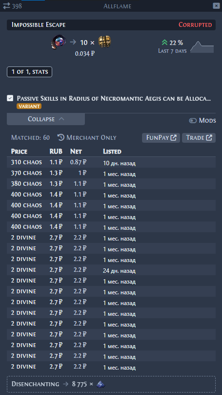

<div align="center">

# Awakened PoE Trade — цены в рублях

**Прайсчекер для Path of Exile с колонкой «Рубли» по курсу FunPay**

[](../../releases/latest)
[](https://www.donationalerts.com/r/parovoz24)


<br>



</div>

---

Это сборка популярного прайсчекера [Awakened PoE Trade](https://github.com/SnosMe/awakened-poe-trade)
с одним важным дополнением: рядом с ценой в divine / chaos / mirror показывается,
**сколько это стоит в рублях** по актуальному курсу с [FunPay](https://funpay.com/chips/173/).

Всё остальное работает как в оригинале: те же горячие клавиши, настройки и интерфейс.

## Возможности

| | |
|---|---|
| 💰 **Колонка «Рубли»** | в таблице лотов и в bulk-обмене, в том же стиле, что и остальные колонки |
| 📈 **Курс с FunPay** | медиана 5 самых дешёвых лотов Divine Orb вашей лиги, обновляется раз в 30 минут |
| ⚖️ **Chaos через дивайн** | курс хаоса = курс дивайна ÷ div/chaos (poe.ninja) — цены в chaos и divine всегда согласованы |
| 🪞 **Mirror of Kalandra** | пересчёт через дивайны: курс mirror → div (poe.ninja) × курс div → ₽ (FunPay) |
| 🎯 **Выбор лиги** | автоматически по лиге прайсчекера или вручную из списка лиг FunPay |
| 🔗 **Кнопка FunPay** | рядом с кнопкой Trade — открывает страницу дивайнов на FunPay |
| ℹ️ **Подсказка с курсом** | наведите мышь на заголовок «Рубли» — лига, курс за 1 div / chaos / mirror, сколько дивайнов в продаже по курсу, когда обновлено |
| 💸 **Своя цена и комиссия** | моя цена = курс ± N%, колонка «На руки» — сколько получите после комиссии FunPay (это же число вводится в форму лота) |
| 📋 **Копирование по клику** | клик по цене в рублях — сумма в буфере обмена, сразу вставляйте в лот на FunPay |
| 📦 **Сумма за стак** | под ценой poe.ninja — цена в рублях за штуку и за весь стак |
| 🌍 **₽ / $ / €** | валюта колонки на выбор |
| 🔄 **Обновить курс** | клик по заголовку «Рубли» обновляет курс сразу |

## Установка

1. Скачайте архив из [**Releases**](../../releases/latest) и распакуйте в любую папку.
2. Закройте обычный Awakened PoE Trade, если он запущен.
3. Запустите **`Awakened PoE Trade (RUB).exe`**.

> [!NOTE]
> Программа не подписана платным сертификатом, поэтому Windows может показать окно
> «Система Windows защитила ваш компьютер». Нажмите **«Подробнее» → «Выполнить в любом случае»**.

Программа портативная — установка не нужна. Если у вас уже был Awakened PoE Trade,
настройки и горячие клавиши сохранятся.

## Настройки

**Настройки → Прайс-чек:**

- **Показывать цену в рублях по курсу** — включить / выключить колонку.
- **Лига на FunPay** — `Авто` (по лиге прайсчекера) или конкретная лига из списка.
  Если с началом новой лиги колонка не появилась — выберите лигу вручную.
- **Валюта** — рубли, доллары или евро.
- **Моя цена относительно курса** — например, `-5`, чтобы встать в начало списка на FunPay.
- **Наценка FunPay для покупателя** — по умолчанию 21.18% (продаёте за 100 ₽ — покупатель видит 121.18 ₽).
  Цены на FunPay — это цены для покупателя, поэтому колонка **«На руки»** = цена ÷ 1.2118.
  Именно число из «На руки» вводится в форму лота на FunPay — покупатель увидит цену из колонки «Рубли».
- **Обновить курс сейчас** — без ожидания 30 минут.

## Как считается цена

```
1. Программа загружает страницу FunPay «Божественные сферы»
2. Оставляет лоты только вашей лиги (PC)
3. Берёт 5 самых дешёвых (если онлайн ≥ 3 продавцов — только онлайн) → медиана = курс дивайна
4. Chaos и Mirror пересчитываются через дивайн по курсу poe.ninja
5. Цена предмета × курс = рубли

   15 divine  × 1.25 ₽               = 18.75 ₽
  300 chaos   × (1.25 ₽ ÷ 388 chaos) =  0.97 ₽
    2 mirror  × 450 div × 1.25 ₽     = 1 125 ₽
```

Хаосы на FunPay продают мало и по разбросанным ценам, поэтому их курс берётся не со страницы
хаосов, а через дивайн — так 300 chaos никогда не окажутся «дороже» 2 divine.

Это цена, за которую валюту **продают** на FunPay. При продаже своей валюты
с учётом комиссии вы обычно получите меньше.

## Поддержать проект

Если сборка пригодилась — можно поддержать автора 🧡

<a href="https://www.donationalerts.com/r/parovoz24"></a>

## Благодарности и лицензия

- Оригинальная программа — [Awakened PoE Trade](https://github.com/SnosMe/awakened-poe-trade)
  от Alexander Drozdov (SnosMe), лицензия MIT.
- Изменения с рублями — parovoz24, та же лицензия [MIT](LICENSE).

Проект не связан с Grinding Gear Games, FunPay или автором оригинального Awakened PoE Trade.
